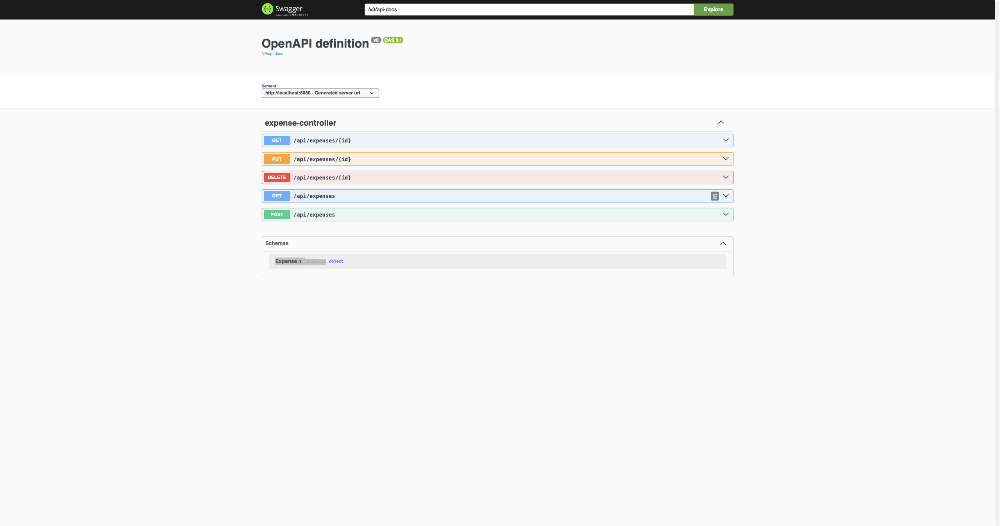

# Expense Tracker – aplikacija za spremljanje stroškov

Spletna aplikacija za spremljanje osebnih stroškov, razvita kot projektna naloga (UM FERI).

## Kazalo

1. [O projektu](#1-o-projektu)
2. [Uporabljene tehnologije](#2-uporabljene-tehnologije)
3. [Struktura projekta](#3-struktura-projekta)
4. [Navodila za nameščanje in zagon](#4-navodila-za-nameščanje-in-zagon)
5. [Navodila za razvijalce](#5-navodila-za-razvijalce)
6. [Standardi kodiranja](#6-standardi-kodiranja)

---

## 1. O projektu

Aplikacija omogoča enostavno spremljanje porabe denarja in boljše upravljanje osebnih financ. Uporabnik lahko stroške **dodaja, pregleduje, ureja in briše** (CRUD), jih **išče po opisu** in **filtrira po kategoriji**.

Vsak strošek vsebuje:

| Polje           | Tip       | Opis                          |
|-----------------|-----------|-------------------------------|
| `id`            | Long      | Samodejno ustvarjen ključ     |
| `description`   | String    | Opis stroška                  |
| `amount`        | double    | Znesek                        |
| `category`      | String    | Kategorija                    |
| `date`          | LocalDate | Datum stroška                 |
| `paymentMethod` | String    | Način plačila                 |

**Cilji projekta:** razvoj REST API-ja (backend), spletnega vmesnika (frontend), shranjevanje podatkov v relacijski bazi in dokumentacija API-ja prek Swaggerja.

### REST API

Osnovni naslov: `http://localhost:8080/api/expenses`

| Metoda   | Pot                                   | Opis                       |
|----------|---------------------------------------|----------------------------|
| `POST`   | `/api/expenses`                       | Dodajanje stroška          |
| `GET`    | `/api/expenses`                       | Vsi stroški                |
| `GET`    | `/api/expenses/{id}`                  | En strošek                 |
| `GET`    | `/api/expenses/search?description=…`  | Iskanje po opisu           |
| `GET`    | `/api/expenses/filter?category=…`     | Filtriranje po kategoriji  |
| `PUT`    | `/api/expenses/{id}`                  | Posodobitev stroška        |
| `DELETE` | `/api/expenses/{id}`                  | Brisanje stroška           |

Swagger UI (ko backend teče): <http://localhost:8080/swagger-ui/index.html>

### Posnetki zaslona

| Glavni zaslon | Swagger |
|---------------|---------|
|  |  |

---

## 2. Uporabljene tehnologije

### Backend

| Tehnologija            | Verzija  |
|------------------------|----------|
| Java (JDK)             | 25       |
| Spring Boot            | 4.1.1    |
| Spring Web MVC         | (v sklopu Spring Boot) |
| Spring Data JPA / Hibernate | (v sklopu Spring Boot) |
| PostgreSQL JDBC gonilnik | (upravlja Spring Boot) |
| springdoc-openapi (Swagger UI) | 2.8.13 |
| Apache Maven (Maven Wrapper) | priložen `mvnw` |

### Frontend

| Tehnologija                | Verzija   |
|----------------------------|-----------|
| React / React DOM          | ^19.3.1   |
| Vite                       | ^8.3.4    |
| @vitejs/plugin-react       | ^6.1.2    |
| ESLint                     | ^10.13.0  |
| Node.js (priporočeno)      | 22 LTS ali novejši |

### Podatkovna baza

| Tehnologija | Verzija |
|-------------|---------|
| PostgreSQL  | 14 ali novejši (priporočeno) |

---

## 3. Struktura projekta

```
.
├── backend/                         # Spring Boot REST API
│   ├── src/
│   │   ├── main/
│   │   │   ├── java/si/feri/backend/
│   │   │   │   ├── BackendApplication.java    # vstopna točka
│   │   │   │   ├── controller/                # REST kontrolerji
│   │   │   │   │   └── ExpenseController.java
│   │   │   │   ├── model/                     # JPA entitete
│   │   │   │   │   └── Expense.java
│   │   │   │   └── repository/                # dostop do baze (Spring Data JPA)
│   │   │   │       └── ExpenseRepository.java
│   │   │   └── resources/
│   │   │       └── application.properties     # konfiguracija (baza, JPA)
│   │   └── test/java/si/feri/backend/         # testi
│   ├── .mvn/wrapper/                          # Maven Wrapper
│   ├── mvnw, mvnw.cmd                         # zagon Mavena brez namestitve
│   └── pom.xml                                # odvisnosti in build
│
├── frontend/                        # React + Vite spletni vmesnik
│   ├── public/                      # statične datoteke (ikone)
│   ├── src/
│   │   ├── main.jsx                 # vstopna točka
│   │   ├── App.jsx                  # glavna komponenta (obrazec, seznam, iskanje, filter)
│   │   ├── App.css, index.css       # stili
│   │   └── assets/                  # slike
│   ├── index.html
│   ├── vite.config.js
│   ├── eslint.config.js
│   └── package.json
│
├── docs/                            # dokumentacija
│   ├── porocila/                    # poročila za vaje (.docx)
│   ├── vaja1/                       # poročilo vaje 1 (Markdown) s posnetki Postmana
│   └── screenshots/                 # posnetki zaslona aplikacije in API-ja
│
├── .env.example                     # primer okoljskih spremenljivk
├── .gitignore
└── README.md
```

---

## 4. Navodila za nameščanje in zagon

### 4.1 Predpogoji

1. **Git** – <https://git-scm.com/downloads>
2. **Java JDK 25** – preverite z `java -version` (npr. Temurin / OpenJDK 25)
3. **Node.js 22 LTS ali novejši** z `npm` – preverite z `node -v` in `npm -v`
4. **PostgreSQL** (strežnik teče na vratih `5432`) – <https://www.postgresql.org/download/>

Maven ni potreben; uporabite priloženi Maven Wrapper (`mvnw`).

### 4.2 Kloniranje repozitorija

```bash
git clone https://github.com/<UPORABNISKO_IME>/<IME_REPOZITORIJA>.git
cd <IME_REPOZITORIJA>
```

### 4.3 Vzpostavitev baze

Ustvarite prazno bazo `moja_baza` (tabele ustvari Hibernate samodejno ob prvem zagonu, `ddl-auto=update`):

```bash
psql -U postgres -c "CREATE DATABASE moja_baza;"
```

Ali v pgAdmin: *Databases → Create → Database…* → ime `moja_baza`.

### 4.4 Okoljske spremenljivke (backend)

Povezava na bazo se bere iz okoljskih spremenljivk. Če jih ne nastavite, veljajo privzete vrednosti v oklepaju.

| Spremenljivka | Opis | Privzeto |
|---------------|------|----------|
| `DB_URL`      | JDBC naslov baze   | `jdbc:postgresql://localhost:5432/moja_baza` |
| `DB_USERNAME` | uporabnik baze     | `postgres` |
| `DB_PASSWORD` | geslo uporabnika   | `postgres` |

Primer (Linux / macOS):

```bash
export DB_PASSWORD=vase_geslo
```

Primer (Windows PowerShell):

```powershell
$env:DB_PASSWORD = "vase_geslo"
```

Primer vrednosti je v datoteki [`.env.example`](.env.example). Gesel ne objavljajte v repozitoriju.

### 4.5 Zagon backenda

```bash
cd backend
./mvnw spring-boot:run        # Windows: mvnw.cmd spring-boot:run
```

Backend je dostopen na <http://localhost:8080>, Swagger UI pa na <http://localhost:8080/swagger-ui/index.html>.

Zagon testov: `./mvnw test`

### 4.6 Zagon frontenda

V novem terminalu:

```bash
cd frontend
npm install
npm run dev
```

Aplikacija je dostopna na <http://localhost:5173>. Frontend kliče backend na `http://localhost:8080/api/expenses`, backend pa dovoljuje zahtevke (CORS) z naslova `http://localhost:5173`, zato morata oba teči hkrati.

Dodatni ukazi: `npm run build` (produkcijski build), `npm run lint` (preverjanje kode).

### 4.7 Pogoste težave

| Težava | Rešitev |
|--------|---------|
| `Povezava z backendom ni uspela` v aplikaciji | Preverite, ali backend teče na vratih 8080. |
| `password authentication failed` | Nastavite pravilen `DB_USERNAME` / `DB_PASSWORD`. |
| `database "moja_baza" does not exist` | Ustvarite bazo (korak 4.3). |
| `invalid target release: 25` | Namestite JDK 25 in preverite `JAVA_HOME`. |

---

## 5. Navodila za razvijalce

### 5.1 Potek dela z Gitom (GitHub Flow)

- Veja `main` je vedno stabilna in zagnana; **neposredno vanjo ne commitamo**.
- Vsako novo funkcionalnost ali popravek razvijamo na svoji veji, ki jo ustvarimo iz `main`.

```bash
git checkout main
git pull
git checkout -b feature/ime-funkcionalnosti
```

### 5.2 Poimenovanje vej

| Predpona    | Uporaba                  | Primer                       |
|-------------|--------------------------|------------------------------|
| `feature/`  | nova funkcionalnost      | `feature/izvoz-csv`          |
| `fix/`      | popravek napake          | `fix/napaka-pri-iskanju`     |
| `docs/`     | dokumentacija            | `docs/posodobitev-readme`    |
| `refactor/` | preoblikovanje kode      | `refactor/expense-service`   |

### 5.3 Commit sporočila

Kratka sporočila v ukazni obliki, ki povedo, *kaj* je bilo narejeno. Uporabljamo predpone (Conventional Commits):

```
feat: dodaj filtriranje stroškov po datumu
fix: popravi izračun zneska pri urejanju
docs: dopolni navodila za zagon
refactor: izvleci poslovno logiko v servis
```

```bash
git status
git add <datoteka>
git commit -m "feat: dodaj filtriranje stroškov po datumu"
git push -u origin feature/ime-funkcionalnosti
```

### 5.4 Pull request

1. Na GitHubu odprite **Pull Request** z veje v `main`.
2. V opisu navedite, kaj je spremenjeno in kako to preizkusiti.
3. Pred oddajo preverite, da se backend zažene in `./mvnw test` uspe.
4. Počakajte na pregled (code review) in popravite pripombe.
5. Po potrditvi veja se zlije v `main` (merge); vejo nato izbrišite.

#### Posodabljanje lokalne kopije

```bash
git checkout main
git pull
```

Če je `main` med razvojem napredoval: `git checkout feature/... && git merge main`.

### 5.5 Kaj se ne commita

Gesel, `.env` datotek, map `target/` in `node_modules/` ter nastavitev IDE-jev (`.idea/`). To urejajo datoteke `.gitignore`.

---

## 6. Standardi kodiranja

### Java (backend)

- Poimenovanje: razredi `PascalCase`, metode in spremenljivke `camelCase`, konstante `UPPER_SNAKE_CASE`, paketi male črke (`si.feri.backend.*`).
- Plasti ločimo v pakete: `controller` (REST), `model` (entitete), `repository` (dostop do podatkov).
- Kontrolerji vračajo ustrezne HTTP statuse (`201 Created`, `404 Not Found`, `204 No Content`).
- Odvisnosti vbrizgavamo prek konstruktorja.
- Uporabljamo ločene vrstice in zamik 4 presledkov; ena javna klasa na datoteko.
- Konfiguracijskih skrivnosti ne vpisujemo v kodo, temveč uporabljamo okoljske spremenljivke.

### JavaScript / React (frontend)

- Komponente `PascalCase`, funkcije in spremenljivke `camelCase`; datoteke komponent s končnico `.jsx`.
- Funkcijske komponente s hooki (`useState`, `useEffect`).
- Zamik 2 presledka, dvojni narekovaji, podpičja.
- Pred commitom zaženite `npm run lint`.

### Splošno

- Imena v kodi so smiselna in opisna.
- Komentarji pojasnjujejo *zakaj*, ne *kaj*.
- Majhni, osredotočeni commiti; en PR = ena tema.

---

## Avtor

Mojsov – UM FERI
