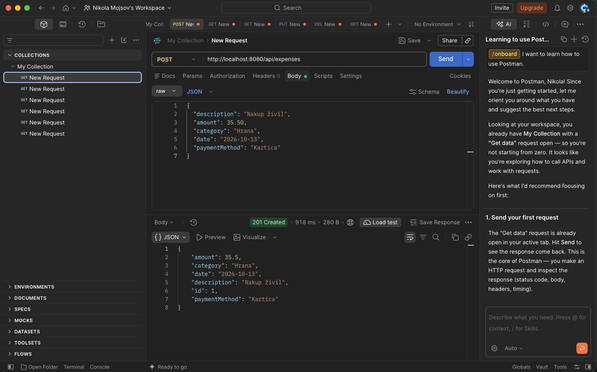
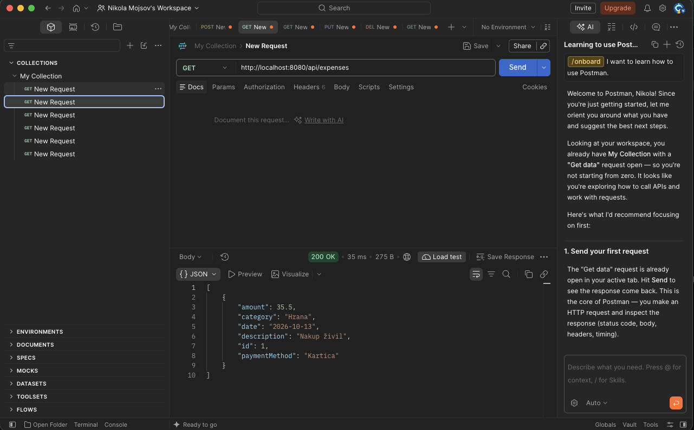
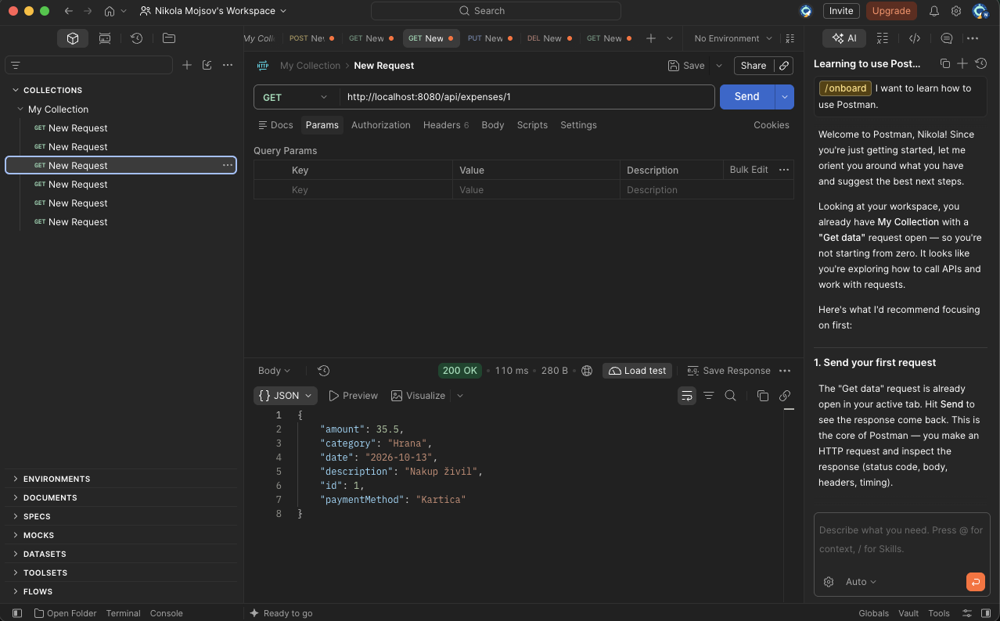
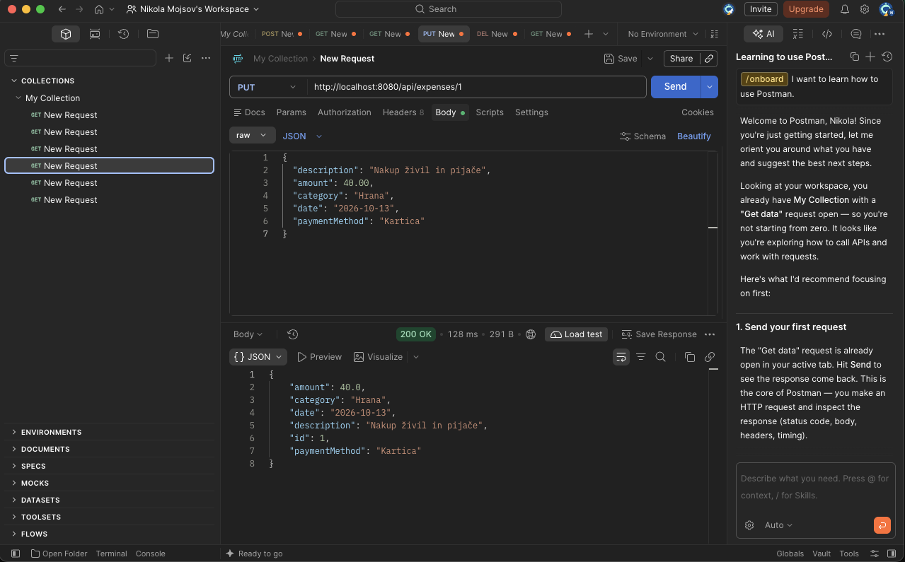
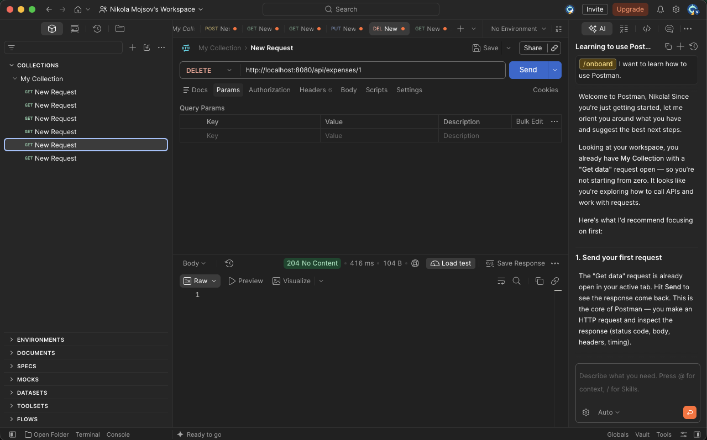

# Vaja 1 – Aplikacija za spremljanje stroškov

## 1. Idejna zasnova

Ideja projekta je razvoj aplikacije za spremljanje osebnih stroškov. Uporabnik bo lahko dodajal, pregledoval, urejal in brisal stroške. Vsak strošek bo vseboval opis, znesek, kategorijo, datum in način plačila.

Namen aplikacije je omogočiti enostavno spremljanje porabe denarja in boljše upravljanje osebnih financ. Zaledni sistem je razvit s tehnologijo Spring Boot in uporablja podatkovno bazo H2 v pomnilniku. Sistem podpira osnovne operacije CRUD, delovanje pa je preverjeno z orodjem Postman.

## 2. Testiranje CRUD operacij

### 2.1. Create – dodajanje stroška

### 2.2. Read – pridobivanje vseh stroškov

### 2.3. Read – pridobivanje posameznega stroška

### 2.4. Update – posodabljanje stroška

### 2.5. Delete – brisanje stroška

